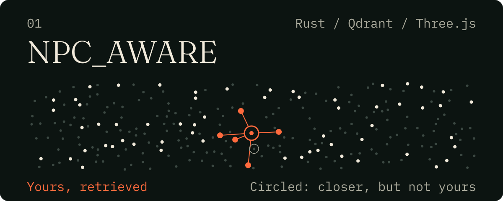
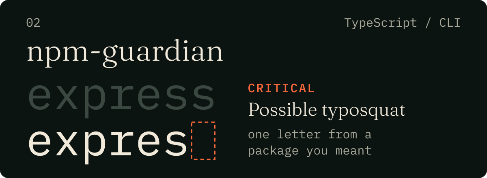
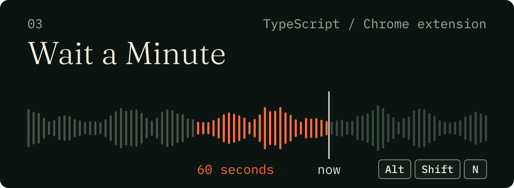
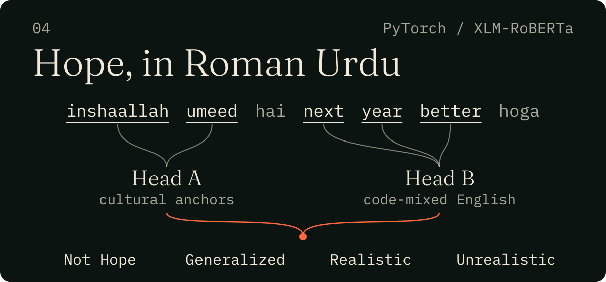

I like the hard part of a product: the memory that has to survive a restart, the model that has to run on a laptop, the check that has to fire before anything executes. Lately that means real-time systems, local AI and developer tools.

## Selected work

**NPCs that remember you, on your own laptop.** Tell Elara the herbalist your plans, close the game, and she still knows them tomorrow. Lie about the past and the lie never enters her memory. Dialogue streams from a local Phi-3 model through a Rust gateway, with no cloud APIs. [Read the code](https://github.com/nosherwan537/Npc_aware)

**Catch a malicious package before its install script runs.** A local scanner for typosquats, dangerous lifecycle scripts, known malware and CVEs. Behavioral checks mean a package published 30 seconds ago can still be caught. [Read the code](https://github.com/nosherwan537/guardian-rep)

**Press one key and the last 60 seconds of a video becomes a note.** You get the speaker's actual words, cleaned up, with a link back to the exact moment. Bring your own API key. There is no backend and no account. [Read the code](https://github.com/nosherwan537/waitaminute)

**A public hope speech dataset for the Urdu people actually type.** A NUST research project with a dual-head XLM-RoBERTa classifier. The best finding was a subtraction: removing our own phonetic normalizer lifted macro F1 from 0.48 to 0.56. [Read the research](https://github.com/nosherwan537/Context-Aware-Multiclass-Hope-Speech-Detection)

## Also on the bench

[claude-brain-sync](https://github.com/nosherwan537/claude-brain-sync) moves Claude Code's project memory between machines. [EpidemiaX](https://github.com/nosherwan537/EpidemiaX) simulates disease spread through a social network. [RepoSage](https://github.com/nosherwan537/RepoSage) answers questions over your documents with RAG. [ControloVol](https://github.com/nosherwan537/ControloVol) controls a PC with hand gestures.

## What I work with

**Languages** &nbsp; TypeScript, Python, Rust, JavaScript 
**Web** &nbsp; React, Next.js, Node.js, FastAPI, PostgreSQL 
**Machine learning** &nbsp; PyTorch, TensorFlow, Qdrant, llama.cpp 
**Shipping** &nbsp; Docker, AWS

Have an interesting problem? [See my portfolio](https://nosherwantahir.vercel.app/) or [message me on LinkedIn](https://www.linkedin.com/in/nosherwan-tahir-7a3799352).
