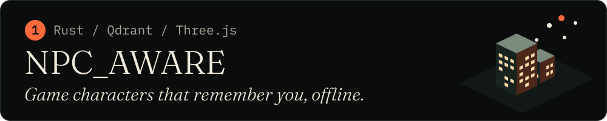
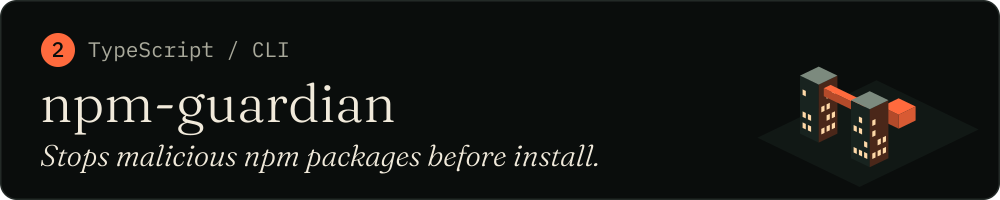
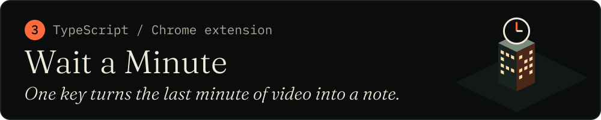
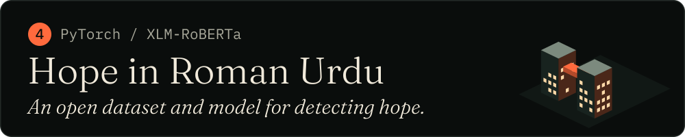
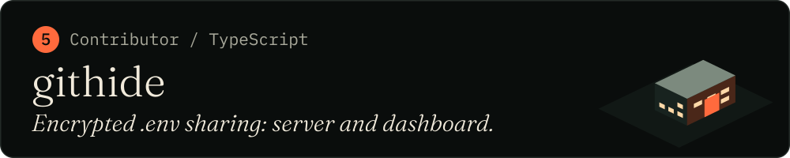
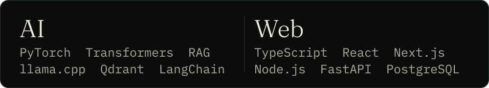

I build AI that runs close to the user and the web products around it.

[See my portfolio](https://nosherwantahir.vercel.app/) &nbsp;·&nbsp; [Message me on LinkedIn](https://www.linkedin.com/in/nosherwan-tahir-7a3799352)
